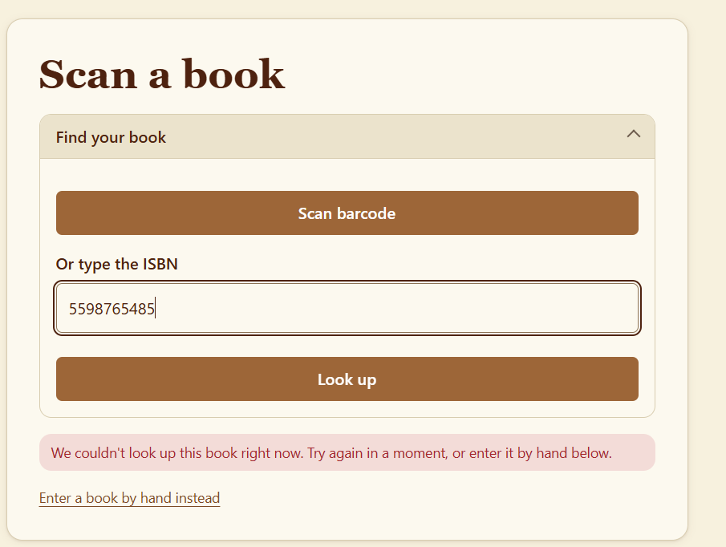

# Show and tell: External data integration

**Learning outcome:** You enrich your application's data by integrating an external data source.
**Rubric row:** External data integration (10%)
**Main work by:** Emad (#51)

## What we built

A user scans a barcode with the phone camera, or types an ISBN, and ShelfPal fetches title, author, publisher and cover from Open Library. This removes the manual typing that every survey respondent complained about. A fetched book is stored once as a shared book, so the next user with the same ISBN gets it from our own database without calling Open Library.

## Proof

| What                                                      | Where to see it                                                                           |
| --------------------------------------------------------- | ----------------------------------------------------------------------------------------- |
| Open Library wrapper, the only file that knows its format | `backend/library/external.py`                                                             |
| Reuse a stored book, otherwise fetch and save             | `get_or_fetch_book` in `backend/library/services.py`                                      |
| Lookup endpoint with 200, 400, 404 and 503                | `GET /api/books/lookup/?isbn=`, `docs/openapi.yaml`                                       |
| Backend tests with the API mocked                         | `test_external_lookup.py`, `test_book_lookup.py`, `test_add_scanned_book.py`              |
| Frontend error handling                                   | CT-17 and CT-18 in `src/test/books/ScanBookPage.test.jsx`                                 |
| Screenshot: lookup unavailable message                    |  |

## What the assessor looks at

| Assessor looks at             | Our answer                                                                                                                                                                                                                                                | Proof                                 |
| ----------------------------- | --------------------------------------------------------------------------------------------------------------------------------------------------------------------------------------------------------------------------------------------------------- | ------------------------------------- |
| What it provides              | Title, author, publisher and cover for an ISBN.                                                                                                                                                                                                           | Scan page                             |
| Complexity                    | Barcode scanning in the browser, ISBN normalising (hyphens, ISBN 10 and 13), transforming Open Library's response into our Book model, a shared catalogue with copy on write when a user edits a shared book. No authentication: Open Library needs none. | `external.py`, `services.py`          |
| When the API is down          | The wrapper raises `ExternalLookupError`, the endpoint returns 503, the page shows a message plus a link to enter the book by hand. Books fetched before still come from our database.                                                                    | CT-18, `test_book_lookup.py`          |
| Alert when the source is down | No rule just for the lookup. A 503 is logged like any other response, so the general "Backend 5xx errors" rule catches it when more than 2 server errors happen within 5 minutes and sends an email.                                                      | `monitoring/backend-alert-rules.yaml` |

## Link to requirements

US-02 Add a book by scanning its barcode. Survey: manual entry is the main pain.

## Decisions and trade offs

- **Open Library only, no Google Books:** one source keeps the wrapper small. Trade off: no second source when Open Library is down.
- **Two steps, lookup then confirm:** the story says the book is added when I confirm. The lookup creates the shared book, only the confirm creates the user's copy.
- **Our database as the cache:** shared books are reused by ISBN. Trade off: data is not refreshed if Open Library improves a record later.

## Problems we ran into

- **Wrong docs at first:** the Read API page instead of the Books API page.
- **Route with a double prefix** (`api/api/books/lookup/`) and an indentation slip that gave 405 on every POST.

## What we learned

### Emad

- **Could not do at the start, can do now:** Before this I had only called APIs directly from code and hoped they answered. Now I know how to put an external source behind one wrapper (`external.py`), so the rest of the app never sees Open Library's format, and how to turn its failures into clear answers: 404 when a book doesn't exist, 503 when the source is down. I also learned to mock the API with `@patch`, so our tests and the pipeline never depend on a website we don't control. And on the frontend, that camera access needs HTTPS and that the browser's own barcode detector isn't supported everywhere, which is why we used a library.

- **Would do differently next time:** I would add a second source, like Google Books, as a fallback, so scanning still works when Open Library is down. I would also give the lookup its own alert instead of relying on the general 5xx rule, because now a short outage of Open Library can go unnoticed. And I would read the API documentation properly before writing code; I started on the wrong page and lost time on it.

- **Already knew before this course:** Making HTTP requests and reading JSON responses. The structure around it, the error handling and the testing.
