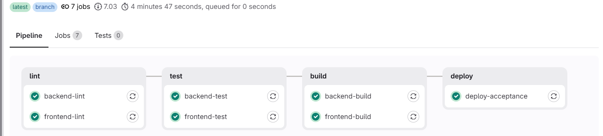

# Show and tell: Deployment pipeline

**Learning outcome:** You set up an automated deployment pipeline for your full stack application to an acceptance and production environment.
**Rubric row:** Deployment pipeline (10%)
**Main work by:** Emad (#71, #72, #83, #85, #40)

## What we built

A GitLab pipeline with the stages lint, test, build, deploy and e2e. A merge into dev builds the images, pushes them to the GitLab registry and deploys them to acceptance automatically. A merge from dev into main waits for a manual click, then deploys the exact images acceptance tested, without rebuilding.

## Proof

| What                                      | Where to see it                                                                                  |
| ----------------------------------------- | ------------------------------------------------------------------------------------------------ |
| Pipeline definition                       | `.gitlab-ci.yml`                                                                                 |
| Deploy script with migrations and seeding | `deploy/deploy.sh`                                                                               |
| Server compose file and settings template | `deploy/docker-compose.server.yaml`, `deploy/.env.server.example`                                |
| Screenshot: a full pipeline on dev        |  |

## What the assessor looks at

| Assessor looks at                           | Our answer                                                                                                                                                                                                                                                             | Proof                                                                |
| ------------------------------------------- | ---------------------------------------------------------------------------------------------------------------------------------------------------------------------------------------------------------------------------------------------------------------------- | -------------------------------------------------------------------- |
| Fully automated, manual gate for production | Acceptance deploys on every merge into dev. `deploy-production` runs on main with `when: manual`.                                                                                                                                                                      | `.gitlab-ci.yml`                                                     |
| Difference between environments             | **Data:** acceptance gets seed users and books, production never (the seed command refuses to run there). **Configuration:** a separate ENV_FILE per environment, scoped in GitLab, with its own secrets and ports. **Access:** separate domains, separate superusers. | `seed.py`, GitLab variables                                          |
| Structure and checks before deploy          | Lint (Ruff, Oxlint, Prettier) and tests (Django, Vitest) must pass before images are built. End to end tests run on acceptance after the deploy.                                                                                                                       | Pipeline screenshot                                                  |
| It actually runs                            | Acceptance and production are live.                                                                                                                                                                                                                                    | https://acc.shelfpal.saxion.college, https://shelfpal.saxion.college |

## Link to requirements

Availability and maintainability QRs. Every story reaches users through this pipeline.

## Decisions and trade offs

- **Promote instead of rebuild:** production takes the SHA of the dev side of the merge commit (`HEAD^2`), so it runs the image acceptance tested. Trade off: dev must always be merged into main with a merge commit, never squashed.
- **Secrets injected from GitLab file variables:** changes need no SSH session. Trade off: more people can read them.
- **No dedicated deploy user:** docker group membership is nearly root anyway. Listed as a known limitation.

## Problems we ran into

- **SSH key without a final empty line** failed with "error in libcrypto".
- **Protected variables never reach feature branches,** so test jobs got their own throwaway SECRET_KEY.
- **Case sensitive folder names:** `Books/` versus `books/` worked on Windows and broke the Linux build.
- **Approving an MR is not merging it:** the first production pipeline never started for that reason.

## What we learned

### Emad

- **Could not do at the start, can do now:** At the start our pipeline only checked code. Now I can build Docker images in CI, push them to a registry and deploy them to a server over SSH without logging in myself. I learned how GitLab variables work: scoped per environment, protected so they only reach protected branches, and stored as files so secrets never appear in a log. I also learned to promote the exact image acceptance tested to production instead of rebuilding it, and that a manual gate is just one line in the pipeline but a real release decision for the team. On the server side I learned that Docker's published ports bypass the firewall, so binding to 127.0.0.1 is what actually protects the containers.

- **Would do differently next time:** Start deploying in the first weeks with an empty app. We deployed late, so every server problem (the snap version of Docker, a server that reset connections, the SSH key format) landed in the busiest part of the project. I would also turn on "Pipelines must succeed" from day one, give the pipeline its own user instead of root, and run the end to end tests before the deploy instead of after it.

- **Already knew before this course:** Running the app locally with Docker Compose. Taking it from my laptop to a real server, with separate environments.

## Use of generative AI

Claude helped design the pipeline and debug the SSH and variable problems. This document was drafted with Claude from our own project notes and checked by us.
