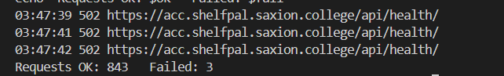

# Show and tell: Update strategy

**Learning outcome:** You employ an update strategy that ensures users experience no disruptions when updates are installed.
**Rubric row:** Update strategy (10%)
**Main work by:** Emad (#70, #86, #40)

## What we built

Each environment runs two backends and two frontends. A deploy first runs the migrations in a throwaway container, then replaces the instances one at a time and waits until each is healthy before touching the next, so there is always one serving. A user with an open tab gets a banner offering to reload when a new version is live.

## Proof

| What                                  | Where to see it                                                                                                                                                                                                                                                                                         |
| ------------------------------------- | ------------------------------------------------------------------------------------------------------------------------------------------------------------------------------------------------------------------------------------------------------------------------------------------------------- | --- | ------------------------- | --------- |
| Deploy order                          | `deploy/deploy.sh`                                                                                                                                                                                                                                                                                      |
| Two backends with health checks       | `deploy/docker-compose.server.yaml`, `backend/healthcheck.py`                                                                                                                                                                                                                                           |
| Backend balancing and retry           | `frontend/nginx.conf`                                                                                                                                                                                                                                                                                   |
| Frontend balancing with health checks | `deploy/Caddyfile`                                                                                                                                                                                                                                                                                      |
| Version banner                        | `frontend/src/shared/ui/UpdateBanner.jsx`, `version.json` (never cached, see `frontend/nginx.conf`)                                                                                                                                                                                                     |
| Design and diagrams                   | Technical design 13.11                                                                                                                                                                                                                                                                                  |
| Zero failure test during a deploy     | During a deploy to acceptance, a script sent a request to the frontend and to `/api/health/` every 0.2 seconds for 5 minutes. Result: 843 requests OK, 3 failed with 502, all on the backend, within 3 seconds. The frontend never failed.  |     | Screenshot: reload banner | [TO FILL] |

## What the assessor looks at

| Assessor looks at                    | Our answer                                                                                                                                                                                                                                             | Proof             |
| ------------------------------------ | ------------------------------------------------------------------------------------------------------------------------------------------------------------------------------------------------------------------------------------------------------ | ----------------- |
| Noticeable downtime                  | No: one instance of each keeps serving while the other is replaced. nginx retries a request on the other backend if one fails (`proxy_next_upstream`), and Caddy only sends traffic to frontends that pass the health check.                           | Zero failure test |
| Migrations                           | Applied automatically by `deploy.sh` before the new backends start. Because the old backend keeps running on the new schema for a moment, migrations must be additive: add first, remove in a later release. [TO FILL: confirm this policy]            | `deploy.sh`       |
| Old frontends after a backend update | The banner checks `version.json` every 5 minutes and when the tab comes back, then offers a reload. Until then the old frontend keeps working because API changes are additive. `index.html` is never cached, so a reload always gets the new version. | Banner screenshot |
| How it is implemented                | Rolling updates behind nginx (backends) and Caddy (frontends).                                                                                                                                                                                         | 13.11             |
| Controlled releasing of features     | Not built. We considered feature flags (django-waffle) and chose not to for this deadline; reasons in 13.11.8. Production does wait for a manual release decision.                                                                                     | 13.11.8           |

## Link to requirements

Availability QR, and the survey: respondents accept planned outages but not lost work.

## Decisions and trade offs

- **Rolling instead of blue green:** no live colour to track, safe when a deploy fails halfway, and both instances serve traffic. Trade off: rollback means redeploying the previous SHA.
- **No feature flags:** see above. Trade off: a feature is either released to everyone or not at all.

## Problems we ran into

- **Port clash on the first deploy:** the old single frontend held the port `frontend-a` needed, so `frontend-b` goes first.
- **Banner test showed nothing:** the tab was opened before the deploy that added the banner.
- **Compose file errors only show on the server:** we now validate it with `docker compose config --quiet` first.
- **failed requests during a deploy:** our zero downtime test found 3 errors (502) in 3 seconds. The deploy log showed why: `backend-b` was replaced in the same second `backend-a` became healthy, but nginx caches backend addresses for 10 seconds (`resolver valid=10s`), and the new `backend-a` had a new address. For a moment nginx had no working backend. The fix is to let `deploy.sh` wait longer than that cache, 15 seconds, before replacing the second backend.

## What we learned

### Emad

- **Could not do at the start, can do now:** Before this course I thought of an update as stopping the app and starting the new version. I didn't know there were strategies to avoid that. I learned two: blue green, where a full second copy runs next to the live one and traffic switches over at once, and rolling updates, where instances are replaced one by one. Our first design was blue green, and I switched to rolling because it has no live colour to keep track of, stays safe when a deploy fails halfway, and both instances serve traffic all the time. Along the way I learned how health checks and load balancing make that work, why migrations must stay compatible with the old version that is still running, and how caching headers decide whether a user ever sees the new frontend at all.

- **Would do differently next time:** Measure zero downtime with a load tool during every deploy instead of checking it by hand once, so it is proven continuously, not just claimed. I would also write the rule "migrations only add, never remove in the same release" down at the start of the project, instead of discovering it while building the deploy script.

- **Already knew before this course:** Nothing on this topic. I had never thought about what happens to a user who is using the app while it is being updated.

## Use of generative AI

Claude helped compare rolling and blue green updates and write the deploy script. This document was drafted with Claude from our own project notes and checked by us.
